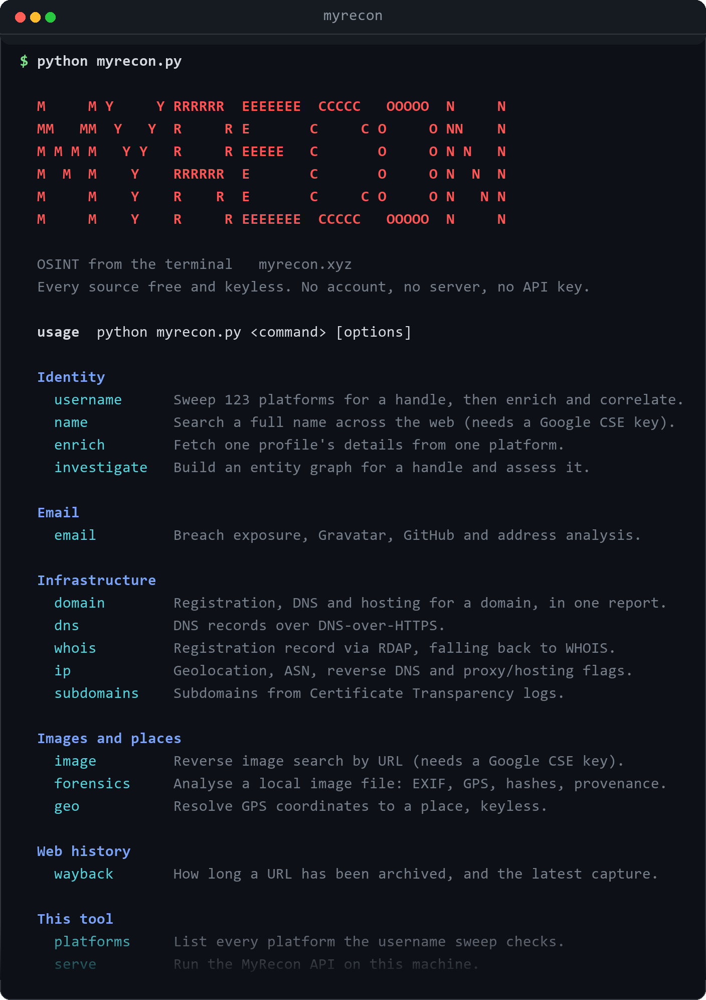

# MyRecon CLI

**Open-source OSINT lookups from your terminal: public username search, email breach exposure, domain, DNS, WHOIS and IP.** It's the same engine that runs [myrecon.xyz](https://www.myrecon.xyz/), MIT-licensed, for digital-footprint self-audits and authorized security research.

```bash
pip install myrecon
myrecon username yourhandle
```

Requires Python 3.10 or newer. Use it on handles, addresses and domains you own or are authorized to investigate.



## Three answers, not two

Every username check returns one of three verdicts:

- **found**: positive evidence, such as profile markup, the handle in the page title, or a user object from an API.
- **not_found**: negative evidence, such as a 404 or 410, or the site's own "no such user" page.
- **unknown**: everything else, including rate limits, bot challenges, login walls and timeouts.

A login wall is never read as "no account", because several large platforms redirect logged-out visitors to a sign-in page even for real profiles. When a page is ambiguous, MyRecon requests the same URL for a random impossible handle and compares the two. That catches sites that return one page for everyone. [Why this matters, with measurements](https://www.myrecon.xyz/guides/why-username-checkers-report-fake-accounts.html).

## Commands

| Command | What it does |
|---|---|
| `myrecon username <handle>` | Check 50 platforms, or 100 with `--deep`. `--all` shows every row, including rejections. |
| `myrecon email <address>` | Breach exposure and public email signals. |
| `myrecon password` | Pwned Passwords check by SHA-1 k-anonymity. Prompts without echo; only a 5-character hash prefix leaves your machine. |
| `myrecon domain <domain>` | Registration, DNS and hosting in one report. |
| `myrecon dns <domain>` | DNS records over DNS-over-HTTPS. |
| `myrecon whois <domain>` | RDAP registration data with a WHOIS fallback. |
| `myrecon ip <address>` | Location estimate, ASN, reverse DNS and hosting signals. |
| `myrecon subdomains <domain>` | Subdomains from Certificate Transparency logs. |
| `myrecon wayback <url>` | How long a URL has been archived, and the latest capture. |
| `myrecon investigate <handle>` | Builds an entity graph for a handle and assesses it. |
| `myrecon forensics <file>` | Metadata and hashes for a local image or document. |
| `myrecon geo <lat> <lon>` | Resolves GPS coordinates to a place, keyless. |
| `myrecon platforms` | Lists every platform the username check covers. |

Add `--json` to any command for machine-readable output, for example `myrecon username yourhandle --json > scan.json`.

Every source is free and keyless except `name` and `image`, which need a Google Custom Search key (`GOOGLE_API_KEY`, `GOOGLE_CX_ID`). Image `forensics` needs `pip install Pillow numpy`. To run the API locally with `myrecon serve`, install the server extras: `pip install "myrecon[server]"`.

## More

- Web app (no install): [myrecon.xyz](https://www.myrecon.xyz/)
- Source, issues and contributing: [github.com/4ryanwalia/Myrecon](https://github.com/4ryanwalia/Myrecon)
- Android app: [Google Play](https://play.google.com/store/apps/details?id=com.Myrecon.osint)
- Breach archive and free data feed: [myrecon.xyz/breaches](https://www.myrecon.xyz/breaches/)

Results describe what public sources returned at the time of the check. A matching handle is not proof of identity, so verify at the source before you rely on a finding.
