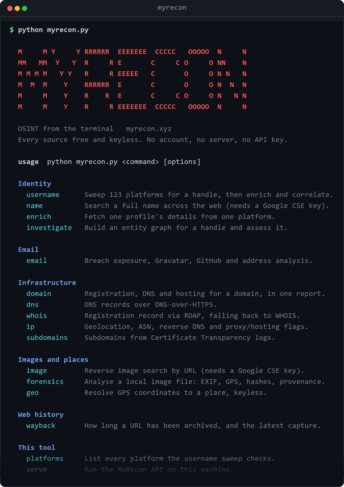
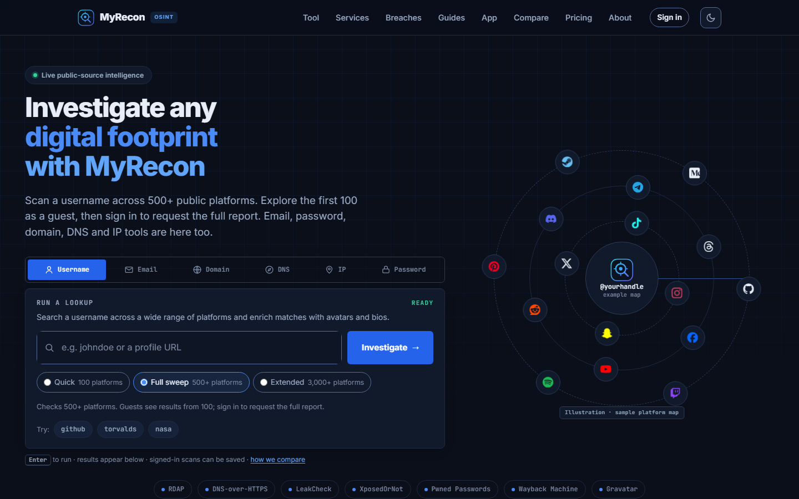

# MyRecon — Open-Source OSINT Tool & Python CLI

**Search public usernames, check email breach exposure, and investigate domains, DNS and IP addresses from your terminal.** MyRecon is an MIT-licensed open-source intelligence (OSINT) toolkit for digital-footprint self-audits and authorized security research, with a Python CLI, web interface and Flask API.

[](LICENSE)
[](pyproject.toml)
[](https://www.myrecon.xyz/)

Public username search · digital footprint audit · email breach checker · WHOIS and DNS lookup · IP intelligence

[Quick start](#quick-start) · [CLI commands](#cli-command-reference) · [JSON output](#json-output-and-automation) · [Offline demo](#try-the-verdict-demo) · [Web app](https://www.myrecon.xyz/) · [Android app](https://play.google.com/store/apps/details?id=com.Myrecon.osint) · [Contribute](CONTRIBUTING.md)

## Quick start

Requirements: **Python 3.10 or newer**, Git, and an internet connection for live lookups. Use a virtual environment to keep dependencies separate from other projects.

```bash
git clone https://github.com/4ryanwalia/Myrecon.git
cd Myrecon
python -m venv .venv
```

Activate it on macOS or Linux:

```bash
source .venv/bin/activate
```

Or in Windows PowerShell:

```powershell
.\.venv\Scripts\Activate.ps1
```

Then install dependencies and run a lookup:

```bash
python -m pip install -r backend/requirements.txt
python myrecon.py --help
python myrecon.py username yourhandle
```

Replace `yourhandle` with a username you own or have permission to investigate. The CLI checks 50 platforms by default; `--deep` checks 100. It runs the shared lookup services locally, without starting the web server. You can also use `python -m cli` from the repository root. If your system uses `python3`, substitute it for `python`.

**CLI `--deep` means a wider username sweep.** It is not the hosted app's separate Deep Search workflow or paid Extended sweep. Provider availability can leave checks incomplete.

```bash
python myrecon.py username yourhandle --deep
python myrecon.py domain example.com
python myrecon.py --help
```



## CLI command reference

Run `python myrecon.py <command> --help` for options. Example addresses and domains below are placeholders; use inputs you own or are authorized to investigate.

| Command | Example | Purpose |
| --- | --- | --- |
| `username` | `python myrecon.py username yourhandle --deep` | Public username search; `--all` shows every row, including rejections. |
| `email` | `python myrecon.py email you@example.com` | Supported breach exposure and public email signals. |
| `domain` | `python myrecon.py domain example.com` | Registration, DNS and hosting in one report. |
| `dns` | `python myrecon.py dns example.com` | DNS records through DNS-over-HTTPS. |
| `whois` | `python myrecon.py whois example.com` | RDAP registration data with a WHOIS fallback. |
| `ip` | `python myrecon.py ip 1.1.1.1` | Location estimates, ASN, reverse DNS and hosting signals. |
| `subdomains` | `python myrecon.py subdomains example.com --all` | Certificate Transparency subdomain discovery. |
| `enrich` | `python myrecon.py enrich GitHub yourhandle` | Public details for a supported platform profile. |
| `wayback` | `python myrecon.py wayback https://example.com` | URL archive history and latest capture. |
| `investigate` | `python myrecon.py investigate yourhandle` | Entity graph and assessment; relationships require verification. |
| `forensics` | `python myrecon.py forensics ./photo.jpg` | Local image metadata, hashes and provenance signals. |
| `geo` | `python myrecon.py geo 51.5074 -0.1278 --radius 1000` | Public place information around coordinates. |
| `name` | `python myrecon.py name "Example Person"` | Full-name web search; requires Google search credentials. |
| `image` | `python myrecon.py image https://example.com/photo.jpg` | Reverse-image web search by URL; requires Google search credentials. |
| `platforms` | `python myrecon.py platforms` | List the username sweep's platform catalogue. |
| `serve` | `python myrecon.py serve` | Start the local Flask API. |

## JSON output and automation

```bash
python myrecon.py username yourhandle --json > username-report.json
python myrecon.py domain example.com --json > domain-report.json
python myrecon.py username yourhandle --all --color never
```

Lookup commands support `--json`, `--quiet` / `-q`, and `--color auto|always|never`. Keep reports out of public repositories: public-source results can still contain personal information. A successful command does not mean every source returned a conclusive result; inspect the verdicts and evidence inside the report.

## Get MyRecon for Android

**See where your username appears publicly online, right from your phone.**

[](https://play.google.com/store/apps/details?id=com.Myrecon.osint)

- Explore public username matches and open profiles to verify them at the source.
- Check email breach exposure and passwords against known leaks.
- Look up domain, DNS and IP information, and inspect QR codes and links.

Start with a username you own. Matching usernames are leads, not proof of identity; unavailable sources can leave results incomplete.

Requires Android 11 or newer. Contains ads. [See the app details](https://www.myrecon.xyz/app.html).

The Android app is maintained separately from this repository's web app, Python CLI and API.



MyRecon is built for self-audits and authorized research. A shared username is not proof that two accounts belong to the same person.

## What problem are we solving?

Digital-footprint checks are often scattered across separate tools, and username search tools can mistake a block page, sign-in wall, or generic HTTP 200 response for proof that an account exists. That creates fragmented investigations and false confidence.

MyRecon brings public username signals, supported breach exposure checks, and domain/DNS/IP research into one web app, Python CLI, and API. Each username result is labeled `found`, `not_found`, or `unknown` according to the evidence available, so an inconclusive lookup stays inconclusive. It is designed for people auditing their own footprint and for authorized research using public sources.

## Username search and digital footprint tools

- **Evidence-aware username results.** A platform is marked `found` only with positive evidence, `not_found` with negative evidence, and `unknown` when a block, sign-in wall, timeout, or ambiguous page prevents a conclusion. An HTTP 200 response alone does not prove an account exists.
- **One place for your exposure checks.** Explore public breach data and email signals, inspect DNS and registration records, and review IP and hosting information.
- **Use the interface that fits.** Search in the browser, run a scriptable CLI locally, or integrate with the HTTP API. The website streams scan progress and supports JSON and CSV exports.

## Guides and measured benchmarks

[Username OSINT guide](https://www.myrecon.xyz/guides/username-osint-search.html) · [Platform profile lookups](https://www.myrecon.xyz/find/) · [Privacy guides](https://www.myrecon.xyz/privacy/) · [OSINT tool comparisons](https://www.myrecon.xyz/vs/)

The [public benchmark dashboard](https://www.myrecon.xyz/#benchmarks) publishes daily measurements for 10 fixed usernames across GitHub, GitLab and Hacker News. Inspect [raw runs and methodology](frontend/data/benchmarks.json) for timestamps, verdicts, coverage and unknown outcomes. Compare actual MyRecon, Sherlock and Maigret runs, with recorded versions and coverage, or select the HTTP 200 heuristic. This small regression sample shares API evidence with the reference; it is not an independent accuracy audit or a full-catalogue ranking. [Reproduce the named-tool benchmark](docs/NAMED-TOOL-BENCHMARKS.md).

## Try the verdict demo

See why a sign-in wall and a timeout stay `unknown`. After cloning this repository, run:

```bash
python examples/offline_demo.py
```

No dependencies, account, API key, or network needed. Four **synthetic examples** show `found`, `not_found`, and `unknown` with evidence and a suggested next step. This illustrates the verdict contract; it is not a live scan or accuracy benchmark. Use `--json` for labeled sample output, or [read the walkthrough](examples/README.md).

## What is included?

| Capability | Website | CLI | Notes |
| --- | :---: | :---: | --- |
| Username sweep and profile evidence | Yes | Yes | The CLI checks 50 platforms by default or 100 with `--deep`; the hosted catalogue is broader. |
| Extended username sweep | Yes | No | A separate hosted sweep; see current plans for coverage and access. |
| Email and breach exposure | Yes | Yes | Checks supported public sources; source availability can vary. |
| Domain, DNS, RDAP/WHOIS, IP, and certificate-transparency subdomains | Yes | Yes | Public infrastructure data. |
| Investigation graph and profile enrichment | Yes | Yes | Relationships are leads to verify, not identity claims. |
| Local image metadata and hashes | No | Yes | Reads a local file without uploading it; install `Pillow` and `numpy` for image decoding. |
| Place lookup from GPS coordinates | No | Yes | Uses public geodata sources to describe coordinates; it does not recognize landmarks in a picture. |
| Password exposure check | Yes | No | Hashes in the browser and sends only a hash prefix to Pwned Passwords. |
| Full-name and reverse-image web search | Yes | Yes | Requires Google Programmable Search credentials. |

**Open-source software and hosted access are different.** This repository is MIT-licensed. Hosted web features have their own guest, signed-in and paid limits, and the CLI, website and Android app do not have identical coverage. See the [current web plans](https://www.myrecon.xyz/pricing) and [Android details](https://www.myrecon.xyz/app.html) for current availability.

The [Android app](https://myrecon.xyz/app.html) is maintained separately; its source is not in this repository.

## How username verdicts work

| Verdict | Meaning |
| --- | --- |
| `found` | The platform returned positive account evidence, such as a user object, profile marker, or a page that differs from a known missing-user control. |
| `not_found` | The platform returned negative evidence, such as a 404/410, a missing-user message, or the same page as a known missing-user control. |
| `unknown` | The platform blocked the request or did not provide enough evidence. This includes challenges, login walls, timeouts, and ambiguous redirects. |

Network conditions and platform behaviour change. Treat results as leads and verify important findings at the source. See [how to verify an OSINT finding](https://myrecon.xyz/guides/verify-an-osint-finding.html).

## Run the website locally

Start the API and static site in separate terminals after installing the backend requirements:

```bash
python myrecon.py serve
```

```bash
cd frontend
python -m http.server 8000
```

Open [http://localhost:8000](http://localhost:8000). The local frontend uses the API on `http://localhost:5000`. Guest lookups work without account configuration; sign-in and paid plans require Firebase and payment-provider settings.

## API

The Flask API lives in [`backend/`](backend/). For example, with the API running locally:

```bash
curl -X POST http://localhost:5000/api/dns -H "Content-Type: application/json" -d '{"domain":"example.com"}'
```

Selected routes include `POST /api/username`, `POST /api/username/stream`, `POST /api/email`, `POST /api/domain`, `POST /api/dns`, `POST /api/whois`, `POST /api/ip`, and `GET /api/health`. Streaming routes send newline-delimited JSON progress and completion events. See [`backend/app.py`](backend/app.py) for the complete route list, including account and plan endpoints.

## Project layout

| Path | Purpose |
| --- | --- |
| [`backend/modules/`](backend/modules/) | Public-source lookup engines and platform verdicts. |
| [`backend/services/`](backend/services/) | Service functions shared by the API and CLI. |
| [`backend/core/`](backend/core/) | Input validation, rate limits, caching, and request controls. |
| [`frontend/`](frontend/) | Static HTML, CSS, and JavaScript for the web app, guides, and breach archive. |
| [`cli/`](cli/) | CLI commands and terminal output. |
| [`backend/tests/`](backend/tests/) | Backend tests. |

The web frontend is deployed from Vercel using [`frontend/vercel.json`](frontend/vercel.json); the API has a Render blueprint at [`backend/render.yaml`](backend/render.yaml). The site also publishes [Breach Files](https://myrecon.xyz/breaches/) and [practical guides](https://myrecon.xyz/guides/).

## Configuration and tests

Core CLI lookups need no API key. Optional integrations and hosted account features use environment variables:

| Variables | Purpose |
| --- | --- |
| `GOOGLE_API_KEY`, `GOOGLE_CX_ID` | Full-name and reverse-image web search. |
| `GITHUB_TOKEN` | Higher GitHub API rate limit for public-source lookups. |
| `FIREBASE_SERVICE_ACCOUNT`, Firebase web configuration | Sign-in and persistent web account state. |
| `RAZORPAY_KEY_ID`, `RAZORPAY_KEY_SECRET`, `RAZORPAY_WEBHOOK_SECRET` | Extended scan pack checkout and webhook handling. |
| `API_BASE_URL` | API origin for the hosted frontend build. |

Keep credentials out of source control. To run the backend test suite:

```bash
python -m pip install pytest
python -m pytest backend/tests -q
```

## Contributing

Contributions are welcome. Read the [contribution guide](CONTRIBUTING.md) for setup, evidence requirements, and the maintainer approval process. Here are useful ways to help:

- **Improve platform coverage:** add or update a platform verdict check and include fixtures or a reproducible example that demonstrates the expected `found`, `not_found`, or `unknown` result.
- **Improve documentation:** clarify setup, API/CLI usage, or how to verify a finding. Keep examples safe to share and grounded in public sources.
- **Strengthen API and CLI tests:** cover a user-visible command or endpoint, including error and uncertain-result cases where relevant.

For substantial or behavior-changing work, open an [issue](https://github.com/4ryanwalia/Myrecon/issues) first to agree on scope. Then submit a focused pull request that links the issue, explains the change, and summarizes relevant test results. Do not include personal lookup results, private data, or API keys. Every pull request requires explicit approval from the project maintainer before merge; submission does not guarantee acceptance.

If MyRecon helps you understand your footprint, [star the repository](https://github.com/4ryanwalia/Myrecon) to help others discover it.

## Security

Do not commit credentials or personal scan results. Earlier repository history included plaintext keys in a legacy configuration file. Treat those keys as compromised and rotate or revoke them; removing a file does not erase Git history.

## License

The code is released under the [MIT License](LICENSE). The MyRecon name and logo are not granted under that license. Third-party data remains subject to its providers' terms.
